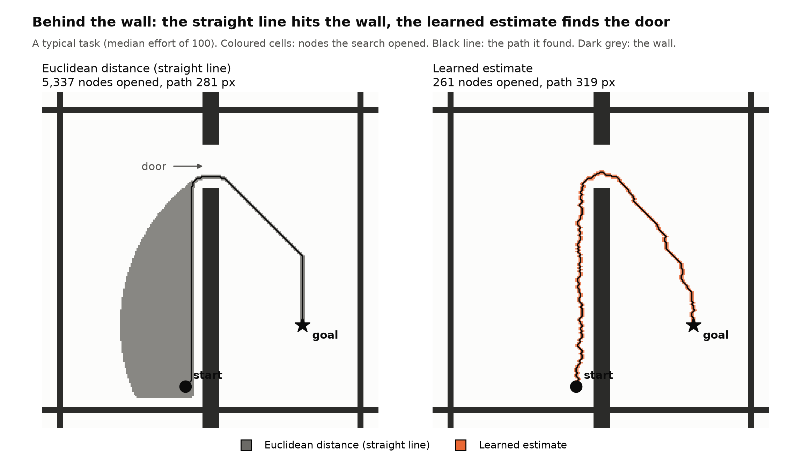
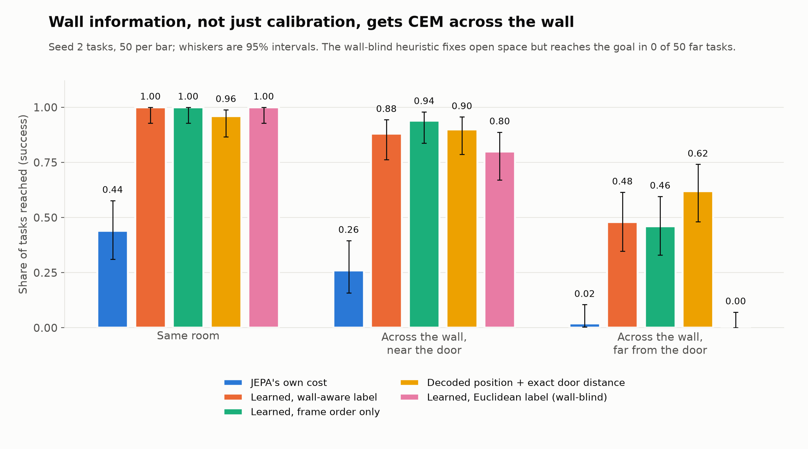
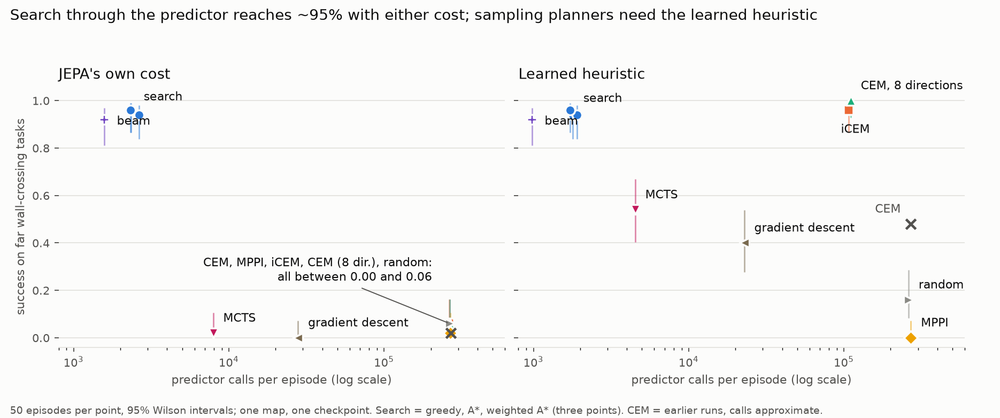
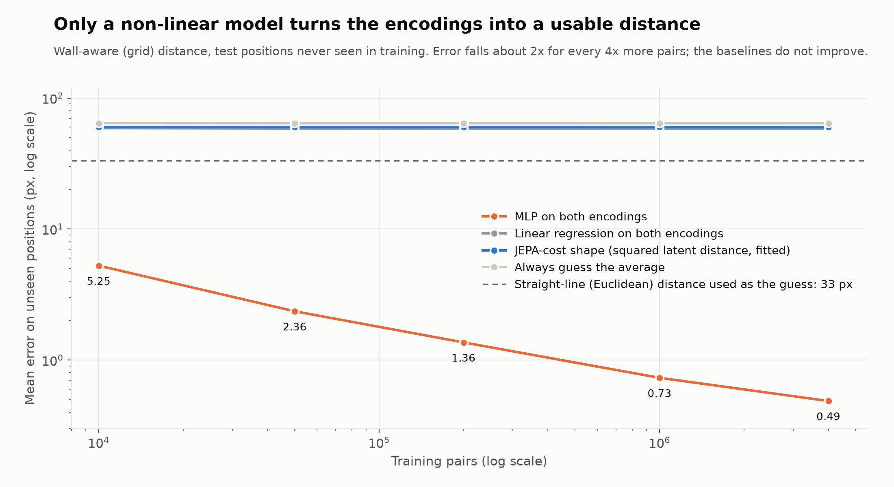
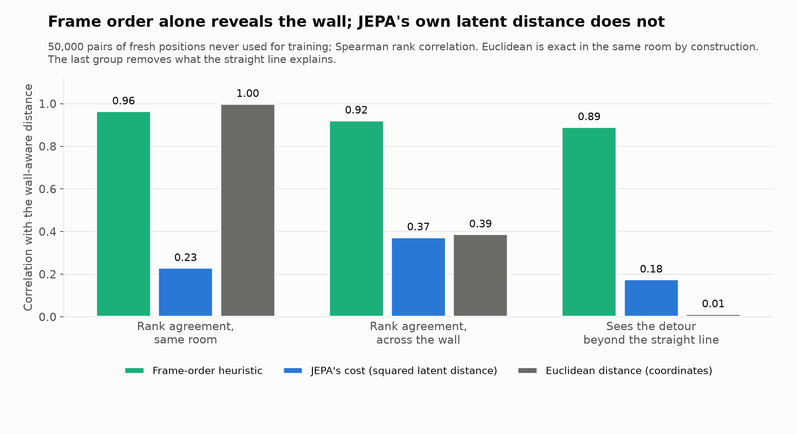
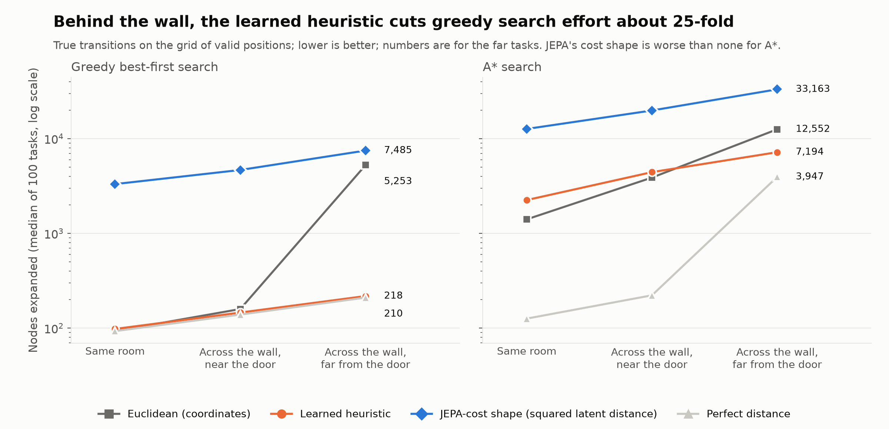
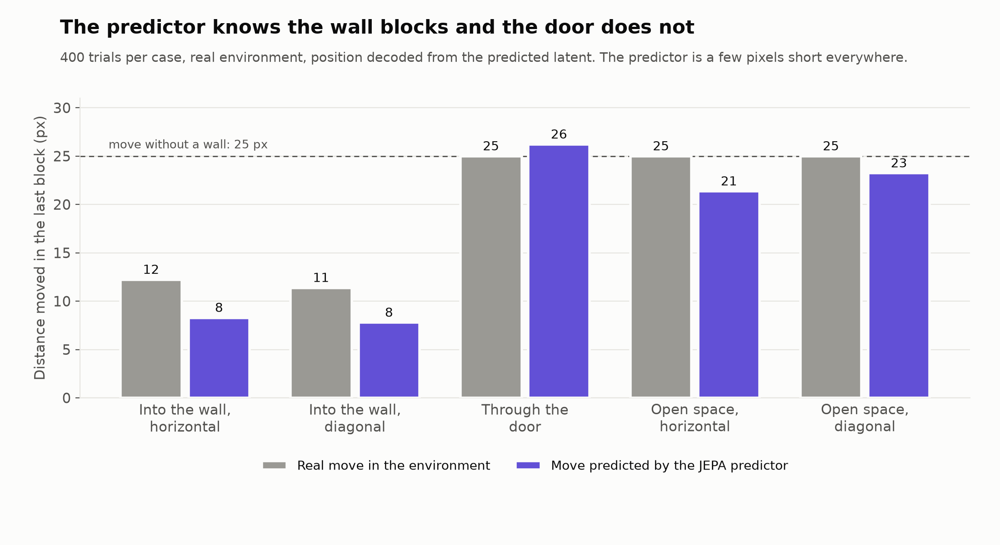

# SE 38 - Design Decision Discussion
#### Aditya Sai Prem
# Planning with a frozen JEPA world model: when the cost misleads, search escapes

**Student:** [your name] · **Module:** SE_38 Planning in Artificial Intelligence · **Project:** "Planning for JEPA", CODE University (supervisor Frank Trollmann) · **Code:** `github.com/frank-trollmann/JEPAHeuristics`, branch `adi/planning`

> **Abstract.** A JEPA world model (LeWM) lets an agent plan from images: it imagines the result of actions in a learned latent space and scores imagined end states by their latent distance to a goal image. On a two-room map, when the goal is behind the wall, this cost points straight into the wall, and LeWM's own planner (CEM) almost never succeeds (2% of hard tasks). I formulate this as a planning problem with a learned transition model, implement **11 planners** (6 sampling-based, 5 tree-search) and **4 heuristics**, and compare them on the same tasks. Two independent design decisions solve the problem: **(1) a learned heuristic** on the frozen latent space (error about 0.6 px; hard-task success of snapped CEM 0.995 and iCEM 0.98 on 200 tasks), including one learned **without coordinates**, from the order of frames in recorded videos; **(2) tree search through the predictor** (A\*, greedy, beam), which reaches 0.93-0.96 on hard tasks **even with LeWM's misleading cost** while using 50-250 times fewer model calls than sampling. With a heuristic learned without coordinates, search still reaches 0.94-0.975 while the best samplers fall to 0.66. The main results are replicated on 200 new tasks. Controls rule out the action set as the explanation, ablations locate where the wall knowledge lives (in the predictor's dynamics, not in latent distance), and diagnostic runs explain why some planners fail.

**Contributions**
1. A formal planning formulation of image-goal navigation with a frozen, learned transition model, and an evaluation protocol that separates easy tasks from tasks where the wall blocks the straight line.
2. A controlled comparison of 11 planners × 4 heuristics on identical tasks, with replication (second task draw, 200-episode draw), controls and sensitivity sweeps.
3. Evidence that **planner structure can compensate for a bad or imperfect heuristic**: search that keeps and merges a frontier escapes the local minimum that traps every sampling planner, and it keeps its success with a coordinate-free heuristic where the samplers lose about 30 points.
4. A learned heuristic on a frozen latent space, including a variant trained without any coordinates or geometry, and an analysis of what it learns (position plus map) and where the wall knowledge sits (the predictor).
5. Diagnosis of failing planners (MCTS fixed by duplicate merging; MPPI partly explained by its fixed spread; the remaining search failures shown not to come from the heuristic).

**How to read this.** The four sections follow the SE_38 template. Experiments are referred to by ID (for example **[S1]**). Appendix A lists every experiment with its question, setup, result and what it does *not* show. Appendix B lists the mistakes I found and fixed. Code locations are given as `file` / `function`.

---

## 1. My Problem

### 1.1 Motivation
A robot with only a camera has to plan using images. A **world model** learns from video how the scene changes when the robot acts, so the robot can imagine the outcome of a plan before it moves. **LeWorldModel (LeWM)** is such a model of the JEPA type (Joint-Embedding Predictive Architecture). An **encoder** turns an image into a 192-number vector *z* (the **latent**), and a **predictor** maps (*z*, action) to the next *z*. LeWM plans with the Cross-Entropy Method (CEM) and a fixed cost: the squared distance between the imagined final latent and the latent of the goal image.

The test case is **TwoRoom**: two rooms separated by a wall with a single door. When the goal is behind the wall, the straight line to it is blocked. A cost that rewards "getting closer in a straight line" then leads the agent into the wall and keeps it there. This is a **local minimum**, the classic failure of greedy planning, and it is the problem this project studies. It matters beyond this map: any learned-model planner whose cost is a distance in a learned space can be misled the same way by obstacles.



*Figure 1. The problem in one picture (exact grid, true transitions, a typical hard task). Left: greedy search guided by the straight-line distance floods the dead end in front of the wall (5,337 nodes). Right: guided by the learned heuristic it heads for the door (261 nodes) [S1].*

### 1.2 Formal problem

| Element | Real environment (execution and scoring) | What the planner works with |
|---|---|---|
| **State** | Agent position (x, y) in a 224 × 224 px image. Fixed layout: wall at x = 112 (10 px thick), door centred at y = 49 (half-width 14), agent radius 7. 29,025 valid integer positions. | A window of latents from the frozen encoder (192-d each). The planner **never sees x, y**: it gets only the current image and the goal image. |
| **Actions** | Continuous 2-D action in [-1, 1]², applied for 5 environment steps (one **action block**, about 25 px at full speed). | Sampling planners: a sequence of 5 blocks in the continuous action space (z-scored with the dataset's action mean and std, as the predictor expects). Search planners: 8 full-speed compass directions per block (my discretisation, §3.4). |
| **Transition model** | Deterministic: the agent moves by the action, and the wall and borders stop it. | The **frozen LeWM predictor** P(latent window, action block) → next latent. It is learned and can be wrong. It does know the wall: a move into the wall is predicted as about 8 px, through the door as 26 px **[D1]**. |
| **Goal** | Agent within 16 px of the goal position (the environment's own test). The goal states are all valid positions in that disc. | The latent of the goal image. A plan scores well when the heuristic says its imagined final latent is close to the goal latent. Search stops early when the estimate is below 10 px. |

**Execution (receding horizon).** The planner plans 5 blocks, all 5 run in the real simulator, and then it replans from the new real image. This is LeWM's own protocol (`utils/cem_planner.py` / `run_episode`). An episode fails if the goal is not reached within 150 environment steps (30 blocks).

**Task sets.** Start and goal positions come only from held-out positions (the test split, never used to train any heuristic), at least 60 px apart, in three kinds (`scripts/run_planning_eval.py` / `sample_tasks`):

| Kind | Definition | Mean straight line / shortest path |
|---|---|---|
| `same_room` | same room | 92 / 92 px |
| `cross_near` | across the wall; the shortest path is at most 15% longer than the straight line | 145 / 154 px |
| `cross_far` | across the wall; the shortest path is at least 50% longer (**the hard case**: the wall blocks the straight line) | 110 / 234 px |

Every planner and heuristic is run on **the same tasks with the same random seeds** (a paired comparison).

### 1.3 Quality criteria and why

| Criterion | Measure | Why it follows from the application |
|---|---|---|
| **1. Success** (primary) | Fraction of episodes that reach the goal, with a 95% Wilson interval, per task kind | A navigation plan is worthless if it doesn't arrive. Reported per kind, because an average would hide the hard case. |
| **2. Compute per decision** | Predictor calls per episode (exact and hardware-independent). Wall-clock seconds as a secondary measure. | On a robot the planner runs inside the control loop, and every imagined step costs one forward pass of a neural network. |
| **3. Path quality** | Steps to the goal. On the exact grid: path cost divided by the optimal cost. | Detours cost time and energy. Secondary, because the task rewards only arrival. |
| **4. Robustness** | Change in success when settings change (merge distance, budget, width, replanning rate) and on new task draws | A planner that works only with a lucky setting will not transfer to a new problem. |

### 1.4 Research questions and hypotheses
- **RQ1.** Can a heuristic *h*(z_agent, z_goal) be learned on the frozen latent space, and does it make planning work where the JEPA cost fails?
- **RQ2.** How do sampling planners and tree-search planners compare under different heuristics, including JEPA's own cost?

Before each experiment I wrote down a hypothesis and what result would refute it (Appendix A). Two of my starting hypotheses turned out wrong: "with the JEPA cost every planner fails" (refuted by search, **[PC1]**) and "the remaining search failures are due to the heuristic" (refuted, **[PC3]**).

---

## 2. My Options

The candidates fall into two families. **Sampling planners** optimise a whole action sequence and are typical for continuous control (model-predictive control). **Search planners** build a tree of discrete choices and are typical for path planning. Both use the predictor as the transition model and a heuristic as the cost.

**Sampling planners** (each samples plans, imagines them with the predictor, and scores the final latent):
- **CEM (Cross-Entropy Method).** Sample 300 plans from a Gaussian, keep the best 30 ("elites"), refit the Gaussian to them, and repeat 30 times. LeWM's planner and the baseline.
- **MPPI (Model-Predictive Path Integral).** Weight the elites by a softmax of their cost and take the weighted average as the new mean; the spread stays fixed. Widely used for robot and vehicle control.
- **iCEM (improved CEM).** CEM with time-correlated ("coloured") noise, reuse of the best plans across iterations, and clipping to the action bounds. A more sample-efficient CEM for robotics.
- *Controls:* **random shooting** (9,000 random plans; the floor), **gradient descent** on the plan through the predictor (a purely local method), and **snapped CEM**, which restricts CEM to the same 8 directions search uses so the action set cannot explain a difference.

**Search planners through the predictor.** Nodes are *imagined* latents. Each node has 8 children (one compass block each), predicted in one batch, and children whose latent is within 12 units of an existing node are merged as duplicates.
- **Greedy best-first.** Expand the node with the smallest h. Fast, but follows a misleading h.
- **A\* / weighted A\*.** Expand by g + h or g + w·h (g = pixels walked). A* is optimal with an admissible h on an exact graph; w > 1 trades optimality for speed.
- **Beam search.** Expand level by level and keep only the k best nodes per level. Bounded memory and compute.
- **MCTS (UCT).** Choose branches by average value plus an exploration bonus. The standard planner for large branching factors and games.
- *Reference:* DFS, greedy, A* and weighted A* on the **exact** position grid with true transitions. This separates "is the heuristic good?" from "is the predictor good?".

**Heuristics (costs).**
- **JEPA cost:** squared latent distance (LeWM's default).
- **Learned heuristic:** an MLP on [z_agent, z_goal] trained on true wall-aware distances.
- **Frame-order heuristic:** an MLP trained only on how many steps apart two frames are in recorded videos. It uses no coordinates and no geometry.
- **Decoded:** read (x, y) from the latent with a small network, then compute the exact wall-aware distance. A diagnostic.

---

## 3. My Solution

### 3.1 Choice
**A\* through the predictor with the learned heuristic**, with beam search (width 5) as the cheaper equivalent. The reasons:
- On the hard tasks it succeeds 0.94-0.95, replicated on 200 new tasks **[PC1, PC3]**.
- It uses about 2k predictor calls and 1 s per episode.
- It is the only family that **keeps working when the heuristic is bad or imperfect**: 0.94-0.96 with the JEPA cost, and 0.94-0.975 with the coordinate-free frame-order heuristic, where snapped CEM and iCEM fall to 0.66 **[PC4]**.
- With the learned heuristic it is insensitive to its settings.

Snapped CEM and iCEM succeed slightly more often (0.98-0.995 on 200 tasks), but at 50-100 times the compute, and they collapse without a good heuristic.

### 3.2 How I got there: the process
The project went through six phases. Each was triggered by a result or a doubt from the previous one.

1. **Can a heuristic be learned at all? (RQ1)** I rendered and encoded every valid position once, together with its coordinates, and split by *position* (70/15/15) so that test positions are never seen in training **[DATA]**. A small MLP learned the Euclidean distance (0.95 px) and then the wall-aware distance (0.49-0.73 px), while plain latent distance explained only R² = 0.10 **[E1, E2]**. *Doubt:* a near-perfect score is suspicious.
2. **Why is it so good?** A probe reads the position from a single latent to 0.89 px **[POS]**, and "decode the position, then look up the map" is almost as good as the learned heuristic (0.94 vs 0.61 px) **[E3]**. So the heuristic is mostly "position plus a fixed map". That raised the question of whether the model knows the wall at all. A dynamics test answered it: the **predictor** stops moves at the wall, but latent *distance* ignores it **[D1]**. Along the way I found that the team's datasets skipped the image normalisation the encoder expects, which made the position 16 times harder to read; I fixed it for the team (PR #6) **[PP]**.
3. **Classical search on the exact grid.** On the true transitions, greedy search with the learned heuristic needs 24 times fewer expansions than with Euclidean on hard goals, and weighted A* (w = 1.5) is about 25 times faster than A* for paths 2% longer **[S1, W1]**.
4. **Plugging the heuristic into LeWM's planner.** I first checked that my CEM matches the official evaluation (84% vs 87.6%) **[C1, C2]**. Swapping the cost then took hard-task success from 2% to 48%, and a heuristic trained only on frame order did the same (48%) **[CEM1, T1, CEM2]**. *Doubt:* half the hard tasks still failed. The failure analysis showed two modes: stuck at the wall, or across the wall but hovering 24-32 px from the goal **[F1]**.
5. **Is it the cost or the planner?** I implemented 10 more planners and ran all of them under the same costs **[PC1, PC2]**. The surprise: **search through the predictor succeeds even with the JEPA cost**. Controls (snapped CEM, beam width 1) and sensitivity sweeps located the reason: keeping a frontier of alternatives.
6. **Hardening.** I tested my own open explanations and the sample size **[PC3, PC4]**: an exact-geometry heuristic, MCTS with duplicate merging, MPPI with an adapted spread, 200 new hard tasks, and the coordinate-free heuristic at 200 tasks.

Working principles throughout:
- **Calibrate before comparing:** my CEM against the official code.
- **Give baselines the same data:** the baselines were refitted at every data size after I noticed they had less data **[E2]**.
- **Ablate to separate causes.**
- **Check search and geometry code against hand-computed cases**, using tolerances rather than float equality.
- **Confirm each new test fails when the code is broken** (mutation checks).
- **Report mistakes openly** (Appendix B).

### 3.3 Results backing the selection

**Out-of-the-box planning is not sufficient.** With the JEPA cost every sampling planner fails on the hard tasks: CEM 0.02, iCEM 0.06, snapped CEM 0.06, MPPI 0.02, random shooting 0.06, gradient descent 0.00 **[PC1, PC2]**. The JEPA cost is also a poor distance in general: R² = 0.10 against the wall-aware distance, worse than the straight line at 0.40 **[E2]**.

**The two design decisions:**

| Decision | Problem property it answers | Evidence (hard tasks) |
|---|---|---|
| **Replace the cost with a learned heuristic** (RQ1) | The JEPA cost points into the wall | CEM 0.02 → 0.42-0.48; iCEM 0.06 → 0.96-0.98; snapped CEM 0.06 → 0.995-1.00 |
| **Search the predictor's tree instead of sampling** (RQ2) | Local minimum: refitting one distribution to the best samples gets trapped | With the JEPA cost: A*, greedy, weighted A* 0.94-0.96; beam 0.92. Snapped CEM with the same 8 actions: 0.05-0.06, so the action set is not the reason. |



*Figure 2. The same CEM with five different costs, 50 tasks per bar, 95% intervals [CEM1, CEM2]. A wall-blind learned heuristic (pink) fixes open space but fails every far task, so it is the wall information, not just a better-scaled distance, that gets CEM across.*



*Figure 3. Success on the hard tasks against compute (log scale), 50 tasks per point, 95% intervals. Left: with JEPA's own cost only search (top left) succeeds. Right: with the learned heuristic the best samplers catch up, at about 100 times the compute. MCTS is shown without duplicate merging; with merging it reaches 0.92 (learned) and 0.72 (JEPA) [PC3].*

**Planner comparison** (hard tasks; 50 tasks, and 200 new tasks where run):

| Planner + learned heuristic | success, 50 / 200 tasks | predictor calls per episode | seconds per episode |
|---|---|---|---|
| **A\*** | 0.94 / **0.95** | ~1.9k | 1.0 |
| Beam (width 5) | 0.92 / 0.96 | ~0.8-1.0k | 0.2 |
| Greedy | 0.94 / 0.95 | ~1.8k | 0.9 |
| Snapped CEM | 1.00 / 0.995 | ~110k | 4.0 |
| iCEM | 0.96 / 0.98 | ~100k | 4.2 |
| MCTS + merging | 0.92 / 0.96 | ~0.9-1.0k | – |
| CEM (LeWM default) | 0.48 / 0.42 | ~225-270k | 8.3 |

### 3.4 How the heuristic was designed and selected
- **Data** (`utils/position_dataset.py`, `utils/pair_dataset.py`) **[DATA]**. Every valid position is encoded once with its coordinates, and pairs are built inside one split only. Images are scaled to [0, 1] and ImageNet-normalised as the encoder was trained (position error 0.9 px instead of 14.3 px without it) **[PP]**.
- **Label** (`utils/reference_distance.py`) **[L1]**. I compared Euclidean, a grid shortest path (Dijkstra), and a continuous door formula (shortest path around the wall grown by the agent radius). I chose the **formula**: the grid overestimates by about 6% because of its 8-direction steps. The choice of label moves cross-wall distances by 11-22 px, far more than the model's 0.6 px error. Which label is "true" matters more than model capacity.
- **Model** (`utils/heuristic_models.py` / `PairMLP`, `train_pair_model`) **[E3]**. Selected on validation pairs, reported on test pairs:

| Model (formula label, 1M pairs, test) | MAE px | overestimates > 2 px |
|---|---|---|
| mean guess / JEPA-cost proxy / linear regression | 60.3 / 56.2 / 54.5 | ~50% |
| metric model ‖f(z_a) − f(z_g)‖ (a true metric) | 1.70 | 18.9% |
| MLP on [z_a, z_g, z_a − z_g] | 0.64 | 1.3% |
| **MLP 384-256-256-1 on [z_a, z_g] (chosen)** | **0.61** | **1.4%** |

  The error keeps falling with more data, from 5.3 px at 10k pairs to 0.49 px at 4M (grid label) **[E2]**. I chose 1M pairs as the trade-off between accuracy and training time. The chosen MLP rarely overestimates, which matters for A*; **[W1]** shows this comes from the label being slightly shorter than the grid cost, not from a guarantee.



*Figure 4. Error of the learned heuristic on unseen positions against training pairs (wall-aware grid label) [E2]. The MLP improves about 2× per 4× data; linear regression and the JEPA-cost shape do not improve at all.*
- **Without privileged information** (`utils/trajectory_dataset.py`) **[T1, CEM2]**. The frame-order heuristic ranks positions almost exactly like the wall-aware distance (Spearman 0.98; detour correlation 0.89 vs 0.18 for the JEPA cost). It matches the learned heuristic with CEM (hard tasks 0.48 vs 0.49, over two task draws) and under search (A* 0.94, beam 0.98) **[PC1, PC2]**. On 200 new hard tasks it works fully **without privileged information** under search (greedy 0.95, beam 0.975), but the best samplers drop to 0.66 (snapped CEM) and 0.665 (iCEM), against 0.98-0.995 with the learned heuristic **[PC4]**.



*Figure 5. The frame-order heuristic, trained without coordinates, ranks positions almost like the true wall-aware distance and sees the detour the wall adds (right group); JEPA's own latent distance and the straight line do not [T1].*

### 3.5 How the planner parameters were selected

| Parameter | Value | How it was chosen |
|---|---|---|
| Sampler budget | 300 samples, 30 iterations, top 30, horizon 5 blocks, execute 5 | LeWM's published config, so the baseline is the real one; calibrated against the official evaluation **[C1, C2]** |
| Search actions | 8 full-speed compass blocks | 63% of recorded action components are exactly ±1; snapped CEM uses the same set as a control |
| Merge distance | 12 latent units | Swept 6 / 12 / 20. At 20 distinct positions merge (0.00); at 6 the JEPA cost drops to 0.20 **[PC2]** |
| Expansions / depth | 100 / 12 blocks | Swept 25 / 100 / 200. Learned: 0.94 at all three; JEPA cost needs ≥ 100 (0.60 at 25) **[PC2]** |
| Beam width | 5 | Width 1: learned 0.98, JEPA 0.14. Width 5 works for both **[PC2]** |
| MCTS exploration c, merging | 0.7, merge 12 | c swept 0.3 / 0.7 / 1.5; merging raised hard-task success from 0.54 to 0.92 **[PC3]** |
| Pixel scale for non-pixel costs | straight-line fit to true distance on validation pairs | A* adds g (px) to h, so h must be in px. Greedy, beam and the samplers use only the *order* of h, so for them the fit changes nothing (except that values below 0 are clamped) |
| Early stop | 10 px (0 for the frame-order heuristic) | The fit read < 10 px at the root for the frame-order heuristic and stopped the search too early. Found and fixed (Appendix B) **[PC1]** |
| MPPI temperature | 0.5 × elite cost spread | Makes MPPI independent of cost scale; 0.1 also tried **[PC1]** |
| Replanning | every 5 blocks | LeWM's setting; every 2 blocks tested: hurts samplers, no effect on search **[PC1, PC2]** |

---

## 4. My Evaluation

### 4.1 Methodology
- **Paired design.** Every planner/heuristic cell runs on the same 50 tasks per kind with the same seeds, so differences are not task luck.
- **Statistics.** Success with a 95% Wilson interval. With 50 tasks the interval is about ±10 points, so only gaps of about 20 points are claims (0.94 vs 0.96 is a tie). With 200 tasks it is about ±3 points.
- **Replication.** A second task draw with a new heuristic training run (seed 4), and an independent draw of 200 hard tasks for the headline cells.
- **Controls and ablations.** Snapped CEM (action set), beam width 1 (frontier), a wall-blind heuristic (wall knowledge), decoded (heuristic accuracy), MCTS with and without merging, MPPI with fixed and adapted spread.
- **Compute.** Predictor calls are counted exactly. Seconds were measured in a separate run with one job on the GPU at a time.

### 4.2 Part 1: correctness and completeness

**Is the implementation correct?**
- **82 unit tests** pass (`.venv/Scripts/python.exe -m pytest utils/tests -q`).
  - Search and geometry are checked against hand-computed cases: a U-shaped corridor, a corner-cutting case, a case where A* must re-open a node, and the door formula against independent bounds (228.6 px, between 214.2 and 235.1).
  - Each planner has a behavioural test on a toy model, for example "reaches a goal 3 blocks away" and "MCTS with merging uses fewer model calls than without".
- **Mutation checks.** For each new planner I broke the code on purpose and confirmed a test failed. This exposed two weak tests, which I fixed.
- **Calibration against the original.** My CEM scores 84% (200 episodes) on LeWM-style tasks; the official LeWM `eval.py` on the same checkpoint scores 87.6% (500 episodes). That is within noise **[C1, C2]**. Rendered frames are pixel-identical to the dataset frames.
- **Reproducibility.** A rerun on another day reproduced an earlier cell exactly (decoded CEM 0.62 = 0.62). The second task draw matches the first within 0.04 on every cell, and the 200-task draw is within 0.06 of the 50-task values **[PC2, PC3]**.

**Does it find an action sequence that reaches the goal?**
- **On the exact grid** (true transitions), A* is complete: it found a path on every task. With the learned heuristic it is optimal on 97-100% of tasks, and weighted A* never exceeded its w·optimal bound **[S1, W1]**. Admissibility is empirical, not guaranteed: trained on the grid label itself, the MLP overestimates at 42% of nodes and A* loses optimality on 9% of hard tasks **[W1]**.
- **Through the predictor**, the planner is **not complete by construction**. The tree has a budget (100 expansions, depth 12), the actions are discretised, the transition model is learned, and duplicate merging keeps the first path to a state, so A* is not guaranteed optimal there. Receding-horizon replanning corrects the predictor's errors with real observations, so completeness is measured empirically, as the success rate.
- **Where the remaining failures come from.**
  - With an exact-geometry heuristic (decoded), search still reaches 0.92 on hard tasks, no better than the learned 0.94-0.96. The last ~5% of failures therefore come from the search budget, the imagined transitions, or the end game, **not from the heuristic** **[PC3]**.
  - For CEM, failures are either stuck at the wall or across the wall but hovering 24-32 px from the goal. Replanning more often converts the first mode into the second **[F1]**.

### 4.3 Part 2: quality criteria

**1. Success.** All planners, hard tasks, 50 tasks per cell:

| Planner | JEPA cost | Learned | Frame-order |
|---|---|---|---|
| A\* | 0.96 | 0.94 | 0.94 |
| Greedy | 0.94 | 0.94 | 0.92 |
| Weighted A\* (w = 2) | 0.96 | 0.96 | – |
| Beam (width 5) | 0.92 | 0.92 | 0.98 |
| MCTS without / with merging | 0.02 / 0.72 | 0.54 / 0.92 | 0.26 / – |
| Snapped CEM | 0.06 | 1.00 | – |
| iCEM | 0.06 | 0.96 | 0.62 |
| CEM | 0.02 | 0.48 | 0.46 |
| MPPI, fixed / adapted spread | 0.02 / 0.04 | 0.00 / 0.18 | 0.02 / – |
| Gradient descent | 0.00 | 0.40 | n/a |
| Random shooting | 0.06 | 0.16 | – |

Same-room and near tasks are easy for almost every planner with the learned heuristic (0.88-1.00). The exception is MPPI with a fixed spread on near tasks (0.66); random shooting was run on hard tasks only.

**Replication on 200 new hard tasks** (interval about ±3 points) **[PC3, PC4]**:

| Planner | Learned | JEPA cost | Frame-order |
|---|---|---|---|
| A\* | 0.95 | 0.96 | 0.94 |
| Greedy | 0.95 | 0.96 | 0.95 |
| Beam | 0.96 | 0.925 | 0.975 |
| MCTS + merging | 0.96 | 0.79 | – |
| Snapped CEM | 0.995 | 0.05 | 0.66 |
| iCEM | 0.98 | 0.04 | 0.665 |
| CEM | 0.42 | 0.02 | – |

Every 200-task cell is within 0.07 of its 50-task value (largest: MCTS + merging with the JEPA cost, 0.72 → 0.79). With the frame-order heuristic the 95% intervals of search (0.90-0.99) and of the samplers (0.59-0.73) do not overlap.

**2. Compute.** Search uses about 0.3-2.6k predictor calls per episode, against 100-270k for the samplers: 50-250 times fewer. In seconds the gap is smaller, 4-40 times (beam 0.2 s, A* 1.0 s, MCTS 2.9 s, snapped CEM 4.0 s, iCEM 4.2 s, CEM 8.3 s, MPPI 10.1 s), because samplers score 300 plans in one GPU batch while search predicts 8 children at a time **[PC2]**.

**3. Path quality.** On the exact grid, greedy with the learned heuristic needs 24 times fewer expansions than Euclidean on hard goals, with the same path quality (1.11 vs 1.12 times optimal). Weighted A* with w = 1.5 costs 2.2% path length for 25 times fewer expansions **[S1, W1]**. In the same room the learned heuristic is slightly *worse* than Euclidean (A* needs 1.6 times the expansions): its small noise costs more than its wall knowledge gains when there is no wall in the way.



*Figure 6. Nodes expanded on the exact grid (median of 100 tasks, log scale) [S1]. Behind the wall the learned heuristic is close to the perfect one for greedy search; the JEPA-cost shape is worse than no heuristic for A*.*

**4. Robustness.** With the learned heuristic, A* stays at 0.88-0.98 across merge distance 6-12, 25-200 expansions and beam width 1-5. With the JEPA cost the same changes drop it to 0.14-0.60. **A good heuristic buys robustness, not only accuracy.** Replanning every 2 blocks instead of 5 leaves search unchanged and hurts the best samplers (iCEM 0.96 → 0.72) **[PC2]**.

### 4.4 Why planners fail: diagnostic experiments
- **Why does search escape the wall?** Search keeps a frontier, so when the best-looking nodes are stuck it expands others. Samplers refit one distribution to the best plans, which all lie at the wall. Evidence: with the same 8 actions, CEM still fails (0.05-0.06), so the actions are not the cause. Shrinking the frontier to one node (beam width 1) destroys the JEPA-cost result (0.92 → 0.14) but not the learned one (0.98). MCTS without duplicate merging wastes its budget re-expanding the same positions and fails. With merging it recovers (0.02 → 0.72 with the JEPA cost) **[PC2, PC3]**. *The mechanism itself was not measured directly.*
- **MPPI.** Refitting its spread helps near tasks (0.66 → 0.90) but not hard ones (0.18). Fixed variance is a cause, not the main one. Hypothesis, untested: averaging elites that go into the wall with elites that go to the door gives a plan that does neither **[PC3]**.
- **Plain CEM vs snapped CEM** (0.42 vs 0.995 on 200 tasks, same cost and budget). Restricting actions to full-speed directions is what makes CEM work here. Hypothesis, untested: less room to slide along the wall.

### 4.5 What the results say
1. **The cost is the main obstacle, but the planner decides whether it can be overcome.** A planner that keeps and merges a frontier of alternatives escapes the wall's local minimum even with LeWM's own cost. Refitting one distribution does not.
2. **The wall knowledge lives in the predictor's dynamics, not in latent distance** (R² 0.10 against the wall-aware distance, while the predictor stops moves at the wall). That is why search through the predictor works without a wall-aware heuristic.



*Figure 7. Movement in one block, real vs predicted by the frozen predictor, 400 trials per case [D1]. The predictor shortens moves into the wall (8 px instead of 25) but not through the door: the wall knowledge is in the dynamics.*
3. **RQ1: yes.** A heuristic can be learned on the frozen latent space to about 0.6 px. It can even be learned without coordinates, from frame order alone, and it turns failing samplers into working ones.
4. **With a good heuristic the choice of planner matters less, but not nothing.** MPPI, plain CEM and gradient descent still fail on hard tasks, for reasons inside the algorithm.
5. **The less you can trust the heuristic, the more search pays off.** With an accurate heuristic search and the best samplers are level (0.95-0.995). With the coordinate-free one, search keeps 0.94-0.975 and the samplers drop to 0.66. With the JEPA cost only search works (0.93-0.96 vs 0.02-0.05). In practice a learned heuristic is never exact, so this is the main argument for choosing search.

### 4.6 Threats to validity (what is not shown)
- **One map and one checkpoint.** The findings are about this setup. The map was fixed in LeWM's training data, so the model has never seen another layout.
- **Privileged information.**
  - The learned heuristic uses true coordinates and geometry as labels.
  - The frame-order heuristic uses none, but the recorded trajectories look like they come from a door-aware expert, so the door knowledge may enter through the data.
  - A* needs h in pixels, and that scale is fitted on true distances. Greedy, beam and the samplers don't need it.
- **Sample size.** 50 tasks per cell for most comparisons (only gaps of about 20 points are claims). 200 tasks for the headline cells.
- **Tuning.** Search settings were tuned on this map; the JEPA-cost result depends on them (§4.3, robustness).
- **Untested hypotheses.** Why snapping helps CEM, why MPPI fails on hard tasks, and the frontier mechanism are explanations consistent with the controls, not measured.
- **Timing.** One laptop GPU (RTX 4050) and 10 episodes per planner. Predictor calls are the reliable measure.
- **External figure not reproduced.** Another paper reports 97.4% for LeWM on TwoRoom. The official code on this checkpoint gives 87.6%, which I quote instead.

### 4.7 Relation to other work
These are positioned from the papers' abstracts.
- **Temporal-distance costs for JEPA planning** (Bai and Xiong, 2026) learn a progress cost from trajectories. My frame-order heuristic is the post-hoc counterpart on a *frozen* model, used inside classical search.
- **Latent Geometry Beyond Search** (Nguyen et al., 2026) replaces search with an inverse-dynamics model.
- **Quasimetric distance learning** (2025-26) motivated my metric-model variant, which was 2.8 times less accurate here.

What this project adds:
- an explicit test on goals where the wall blocks the straight line;
- the finding that **tree search with the model's own cost** already solves them;
- the location of the wall knowledge in the predictor.

### 4.8 How to reproduce
```
.venv/Scripts/python.exe -m pytest utils/tests -q
.venv/Scripts/python.exe -m scripts.generate_position_dataset --seed 0
.venv/Scripts/python.exe -m scripts.run_planner_comparison --planners astar icem --heuristics learned jepa --kinds cross_far --tag _demo
.venv/Scripts/python.exe -m scripts.summarize_planner_comparison
```
`--seed 2` gives the main tasks, `--seed 4` the replication, and `--episodes 200` the 200-task draw. Every result table above comes from a tagged run of `scripts/run_planner_comparison.py` or one of the earlier runners named in Appendix A.

---

## Appendix A: Experiment catalogue

Each entry: **question / hypothesis** → **setup** → **result** → **what it does not show**. "Hard" means `cross_far`.

**[DATA] Position dataset.** All valid positions (agent disc fully inside the free space) are rendered once and encoded by the frozen encoder; split by position 70/15/15 (20,317 / 4,353 / 4,355). Pairs are drawn inside one split. Code `utils/position_dataset.py`, `scripts/generate_position_dataset.py`. 29,025 positions; about 25% of the naive sampling range is invalid. Encoding all of them takes about 3 minutes.

**[E1] Learn the Euclidean distance.** *Can (z_agent, z_goal) predict pixel distance?* MLP 384-256-256-1, 200k pairs, 3 seeds; `scripts/run_label_experiment.py`. **MLP 0.95 px MAE (R² 0.999)**; latent distance R² 0.09, linear regression 0.18. *Not shown:* this tests interpolation between nearby positions, not unseen regions.

**[E2] Learn the wall-aware (grid) distance.** Same setup, grid Dijkstra label, 10k-4M pairs. MLP **5.26 → 2.36 → 1.36 → 0.73 → 0.49 px** (10k → 4M). Euclidean as a guess: 3.8 px same room but **62.6 px across the wall**. Latent distance and the JEPA-cost proxy: **R² ≈ 0.10**, no better than a constant. Baselines were refitted at every size (fairness fix); they do not improve with data. *Not shown:* whether the model "understands" the wall (see [POS], [E3]).

**[POS] Position probe.** *Can (x, y) be read from one latent?* Linear 3.85 px; **MLP 0.89 px** mean error on test positions. So near-perfect distance scores are largely "readable position plus a fixed map".

**[L1] Label comparison.** Grid vs continuous door formula vs thin-wall formula on 200k test pairs. The grid is 5.8% longer than the formula on average; ignoring wall thickness and agent size changes cross-wall distances by about 11 px. **Label uncertainty (11-22 px) is far larger than model error (0.6 px).** Two geometry bugs were caught by hand checks (Appendix B).

**[E3] Other models, formula label.** MLP **0.61 px** (1M pairs), MLP with difference input 0.64, metric model 1.70 (overestimates 19%), **decode-position-then-map 0.94 px**, Euclidean 25.7, JEPA-cost proxy 56.2. The learned heuristic is about 1.4% overestimating (> 2 px). *Not shown:* the metric model was not tuned.

**[D1] Does the predictor know the wall?** Real blocks into the wall, at the door, and in the open; predicted movement decoded with the probe; 400 trials per condition. Real: wall 12 px, free 25 px. **Predicted: wall 8.3 px, door 26.2 px, open 21-23 px.** The predictor has learned that the wall blocks. It is imprecise about where the agent stops (correlation 0.5-0.6). A design error (open-space trials starting outside the map) was found and fixed before the final run.

**[PP] Encoder preprocessing.** *Does feeding raw 0-255 pixels (as the team's generators did) change the latents?* Position probe **14.27 px (raw) vs 0.89 px (normalised)**; heuristic 15.7 vs 0.64 px. I checked that the team's 10M-row dataset used raw input. The fix was merged for the team (PR #6).

**[C1] Calibration of my CEM.** Line-by-line check against the library (samples, elites, horizon, action scaling, success test). LeWM-style tasks: **84%** (200 episodes).

**[C2] Official evaluation.** Unmodified `le-wm/eval.py` on the same checkpoint, 10 seeds × 50 episodes: **87.6%** (interval 84-90%). My CEM is consistent with it. The 97.4% reported elsewhere is not reproduced.

**[S1] Classical search on the exact grid.** DFS, greedy and A* with none / Euclidean / latent / learned / perfect heuristics; 100 tasks per kind (seed 3); `utils/search.py`, `scripts/run_search_eval.py`. Hard tasks, greedy: **learned 218 expansions vs Euclidean 5,253** (paired ratio 24.6, CI 20.5-28.6), same path quality. A* learned 7,194 vs 12,552. Latent-distance heuristics are worse than no heuristic for A*. DFS paths are 44-97 times longer than optimal. In the same room the learned heuristic is worse than Euclidean. *Not shown:* the transitions are true, not predicted.

**[W1] Weighted A* and admissibility.** w ∈ {1, 1.5, 2, 3, 5}. Hard tasks: **w = 1.5 cuts expansions 7,194 → 282 for paths 2.2% longer**. With Euclidean behind the wall, larger w makes things worse (12,552 → 27,938). The w·optimal bound was never violated. The MLP trained on the grid label overestimates at 42% of nodes, and A* loses optimality on 9% of hard tasks.

**[CEM1] CEM with the learned heuristic.** Same CEM, only the cost swapped; 50 tasks per kind (seed 2). Same / near / hard: **JEPA 0.44 / 0.26 / 0.02; learned 1.00 / 0.88 / 0.48**. Ablations:
- a wall-blind heuristic (Euclidean label) gives 1.00 / 0.80 / **0.00**, so it fixes open space but not the wall;
- decode-then-formula gives 0.96 / 0.90 / 0.62.

**[T1] Frame-order heuristic.** 76k frames from 4,000 recorded episodes; label = steps between two frames of the same episode; split by episode. Against the wall-aware distance on fresh renders: **Spearman 0.976** (across the wall 0.92), **detour correlation 0.89** (JEPA cost 0.18, Euclidean 0.01). *Caveat:* the recorded trajectories may come from a door-aware expert.

**[CEM2] CEM with the frame-order heuristic.** Same tasks: **1.00 / 0.94 / 0.46**. Second draw (seed 4): JEPA 0.44 / 0.28 / 0.00, learned 1.00 / 0.88 / 0.50, frame-order 0.98 / 0.90 / 0.50. Pooled hard tasks: **JEPA 0.01, learned 0.49, frame-order 0.48**.

**[F1] Why CEM fails on hard tasks.** Seven settings, 50 hard tasks each. Baseline 48%, replan every 2 blocks 72%, 300-step budget 62%, horizon 8 58%, horizon 12 30%, 1000 samples 18%. **Two failure modes:** stuck at the wall (baseline, more samples), or crossed but hovering 24-32 px from the goal (more replanning, longer horizon). *Not shown:* why 1000 samples is worse (hypothesis: the fixed 30 elites become 3% and the distribution collapses).

**[PC1] Planner comparison I.** MPPI, iCEM, greedy, A* and weighted A* through the predictor, × JEPA / learned / frame-order; 150 tasks (seed 2); `scripts/run_planner_comparison.py`. **Search with the JEPA cost 0.94-0.96 on hard tasks; every sampler with the JEPA cost 0.02-0.06.** Controls:
- snapped CEM gives learned 1.00, JEPA 0.06;
- A* replanning every 2 blocks shows no gain;
- MPPI at temperature 0.1 still fails.

The frame-order heuristic first failed under search (0.56-0.64) because of an early-stop calibration bug of mine; with the fix it gives A* 0.94 and greedy 0.92.

**[PC2] Planner comparison II.** Beam, MCTS, gradient descent, random shooting; sensitivity sweeps; seed-4 replication; clean timing.
- **Beam (w = 5): 0.92 with both costs.** MCTS: 0.54 / 0.02. Gradient descent: 1.00 same room, 0.40 hard (learned).
- Sweeps: merge distance 6 / 20 → learned 0.88 / 0.00, JEPA 0.20 / 0.00. Expansions 25 → JEPA 0.60. Beam width 1 → JEPA 0.14, learned 0.98.
- Seed 4: every cell within 0.04 of seed 2.
- Timing: beam 0.2 s, A* 1.0 s, CEM 8.3 s per episode.

**[PC3] Hardening I.**
- **Decoded heuristic:** search stays at 0.92 on hard tasks, so the heuristic is not the limit. Decoded CEM reproduced [CEM1]'s 0.62 exactly. Decoded iCEM and snapped CEM scored 0.78 and 0.82, below the learned heuristic; hypothesis: the snap makes the cost piecewise constant.
- **MCTS with merging:** 0.92 (learned) and 0.72 (JEPA), up from 0.54 and 0.02, using 3-5 times fewer calls.
- **MPPI with adapted spread:** near 0.90, hard 0.18 (learned).
- **200 new hard tasks:** search 0.925-0.96 with both costs; iCEM 0.98 / 0.04; snapped CEM 0.995 / 0.05; CEM 0.42 / 0.02 (learned / JEPA).

**[PC4] Hardening II: no privileged information, 200 new hard tasks.** Frame-order heuristic with greedy, beam and A* (early stop off) and with snapped CEM and iCEM; MCTS with merging. Greedy, beam and the samplers use only the order of h, so these runs use **no coordinates or geometry anywhere**. A* is listed for comparison and needs the fitted scale. Results (95% interval): **greedy 0.95 (0.91-0.97), beam 0.975 (0.94-0.99)**, A* 0.94 (0.90-0.97); **snapped CEM 0.66 (0.59-0.72), iCEM 0.665 (0.60-0.73)**; MCTS + merging learned 0.96 (0.92-0.98), JEPA 0.79 (0.73-0.84). So without any privileged information, search planners reach the level they reach with the learned heuristic, while the samplers lose about 30 points. The samplers' 50-task value (iCEM 0.62) is confirmed. *Not shown:* why the samplers need a more accurate heuristic than search (hypothesis: the frame-order heuristic is noisy in absolute value, which matters when 300 plans are compared at once, but not much when search only compares neighbours and can back off).

## Appendix B: Mistakes found and fixed
1. **Missing encoder normalisation** in the team's data generators (raw 0-255 input). Position error 14 px instead of 0.9 px. Measured, then fixed for the team (PR #6) **[PP]**.
2. **Unfair baseline comparison:** baselines were fitted on 200k pairs while the MLP got up to 4M. I refitted them at every size; their results did not change **[E2]**.
3. **Geometry bugs in the door formula.**
   - A square grown wall left 393 positions with no path; fixed with rounded corners.
   - Exact float comparisons made the visibility test asymmetric (a path 20 px too long); fixed with tolerances.
   Both were caught by hand-computed checks **[L1]**.
4. **Dynamics-probe control started outside the map**, giving 11.5 px of noise. Fixed, and a test now checks that every trial stays inside the map **[D1]**.
5. **Early-stop calibration bug.** The pixel fit made the frame-order heuristic stop the search at the root, which made that heuristic look bad (0.56-0.64). Fixed with the early stop off (0.92-0.98) **[PC1]**.
6. **Two weak tests** were found by mutation checks and strengthened **[PC2]**.
7. **Contaminated timings.** Early seconds were measured with several jobs sharing the GPU (and once across a laptop sleep). Replaced by a clean single-job timing run; success rates and call counts were unaffected **[PC2]**.
8. **Git slip.** One early commit contained only a file rename because a staging step failed silently. It was fixed in a follow-up commit, without rewriting history.
